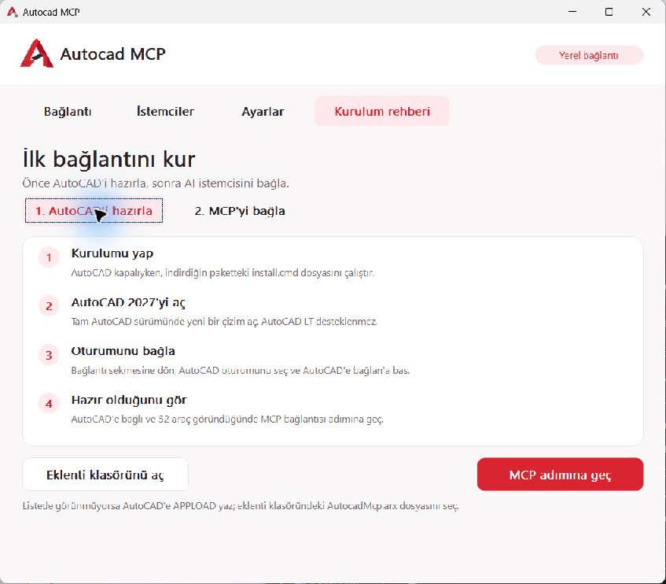

<div align="center">


# Autocad MCP

**Connect your AI assistant to AutoCAD. Draw, inspect and edit on your own computer.**

[](https://github.com/mustafamertakceylan/Autocad-MCP/releases/download/v1.0.0/Autocad-MCP-1.0.0-Windows-x64.zip)
[](https://github.com/mustafamertakceylan/Autocad-MCP/releases)
[](LICENSE)

**English** · [Türkçe](README.tr.md)

[Windows setup](docs/WINDOWS_KURULUM.md) · [52 tools](docs/TOOL_CATALOG.json) · [Build from source](docs/GELISTIRME.md)

</div>

Autocad MCP is an open-source bridge between full AutoCAD 2027 and Codex, Claude Code, OpenCode or other local STDIO MCP clients. The bridge runs on your computer: no central server, network port or bridge-specific API key is required. Model access and any data sent to a cloud model depend on your AI client's settings.



**Current target: Windows x64 and full AutoCAD 2027.** AutoCAD LT is unsupported. Mac Apple Silicon is a separate development phase; no Mac package is available yet. The application UI is currently Turkish; the README is available in English and Turkish.

**v1.0.0 is an unsigned Windows preview.** Windows/AutoCAD may show publisher or trust prompts. Separate clean-machine acceptance, real reboot/startup and trusted ARX/EXE signing remain unfinished. Review the [release notes](docs/releases/v1.0.0.md) and the SHA256 sidecar before use.

### Get started

1. Extract the released Windows ZIP and run **install.cmd** while AutoCAD is closed.
2. Open a drawing in AutoCAD 2027. In **Autocad MCP**, select the session and click **AutoCAD'e bağlan** (connect to AutoCAD).
3. Open **Kurulum rehberi → MCP'yi bağla** (setup guide → connect MCP) and select your client. For Codex desktop/IDE, copy the command and arguments. For CLI clients, prepare an empty workspace in **İstemciler** (clients).
4. Ask your assistant: **“Check the AutoCAD connection status.”** The app shows the CAD connection and MCP client connection separately.

If the plugin is missing from the session list, use **Eklenti klasörünü aç** (open plugin folder), then load `AutocadMcp.arx` with AutoCAD's `APPLOAD`. Review trust prompts yourself; the app does not change AutoCAD security settings.

For later sessions, keep the same client configuration and connect the AutoCAD session again. Closing the window keeps the app in the system tray. **Windows ile başlat** (start with Windows) is optional and off by default; when enabled, it starts in the tray without forcing the window open.

### What can you do?

- Query drawings and entities; create, move, transform and edit 2D geometry.
- Work with real dimensions, text, layers, linetypes, hatches and blocks/attributes.
- Use solids, extrusion, revolution, booleans, drilling and mass properties with explicit density.
- Create sections, BOM/tables, cameras, scaled layouts/PDFs and controlled xrefs.
- Target an explicit drawing with unit/revision checks; save separate DWG copies and run supported operations in atomic batches.

52 tools do not cover every AutoCAD feature. Surfaces/meshes, arbitrary AutoLISP/commands and remote HTTP access are outside the current scope. Check AI-generated dimensions and projections independently: a successful tool call is not engineering approval. See [support and limits](docs/YETENEK_MATRISI.md).

### AI clients and skills

| Client | Connection |
|---|---|
| Codex desktop / IDE | Local STDIO command and four separate arguments shown in the guide |
| Codex CLI | Generated `codex` workspace and project MCP configuration |
| Claude Code | Generated `claude/.mcp.json` and the existing skill |
| OpenCode 1.x | Generated `opencode` workspace and local MCP configuration |
| Other STDIO clients | Manual command/argument setup; compatibility needs client-specific verification |

The existing `autocad-mcp` skill and three fixed MCP resources are included. A new general engineering-drawing accuracy skill is deferred. Claude Code configuration is prepared; a live Claude model has not been tested. These setup paths do not establish OpenCode2.x or Claude Desktop support.

### Validation and development

Dated Windows development evidence covers 47 common tests, 338 native CAD checks, 23 reconnect checks and 28 installation checks. The latest GUI guide, command copy and client selection were exercised; CTest passed 2/2. The [acceptance record](docs/TEKNIK_DENEME_KABUL.md) identifies which version each result belongs to and which checks were not run. These results do not replace separate clean Windows acceptance.

Source development requires Node 24+, CMake, appropriate Visual Studio C++ tools and the separately licensed ObjectARX 2027 SDK:

```powershell
npm ci --ignore-scripts
npm run check
npm test
```

See the [developer guide](docs/GELISTIRME.md) for native builds, isolated AutoCAD testing and packaging. The end-user package bundles Node; users do not need the SDK or a compiler.

### Contributing and community

[Contributing](.github/CONTRIBUTING.md) · [Code of Conduct](.github/CODE_OF_CONDUCT.md) · [Security policy](.github/SECURITY.md) · [Report an issue](https://github.com/mustafamertakceylan/Autocad-MCP/issues/new/choose)

Bug, feature and drawing/PDF forms accept English or Turkish. Use synthetic examples and follow the security policy for vulnerabilities.

### License and credits

[Apache 2.0](LICENSE) · [Notice](NOTICE) · [Third-party licenses](THIRD_PARTY_NOTICES.md) · [Release notes](CHANGELOG.md)

AutoCAD and ObjectARX are Autodesk products with separate licenses. This independent project is not affiliated with or endorsed by Autodesk; neither AutoCAD nor its SDK is included. The original application logo was generated with imagegen; see its [creation notes](desktop/assets/README.md).
